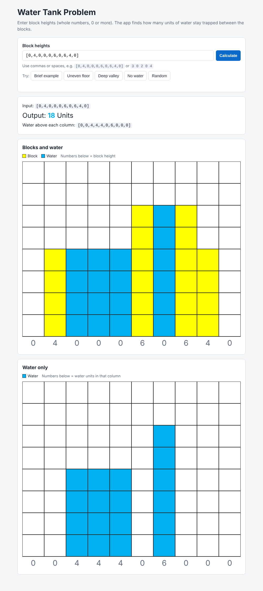
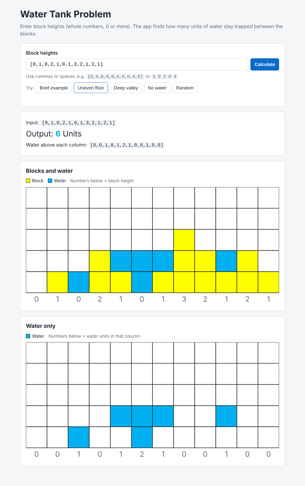
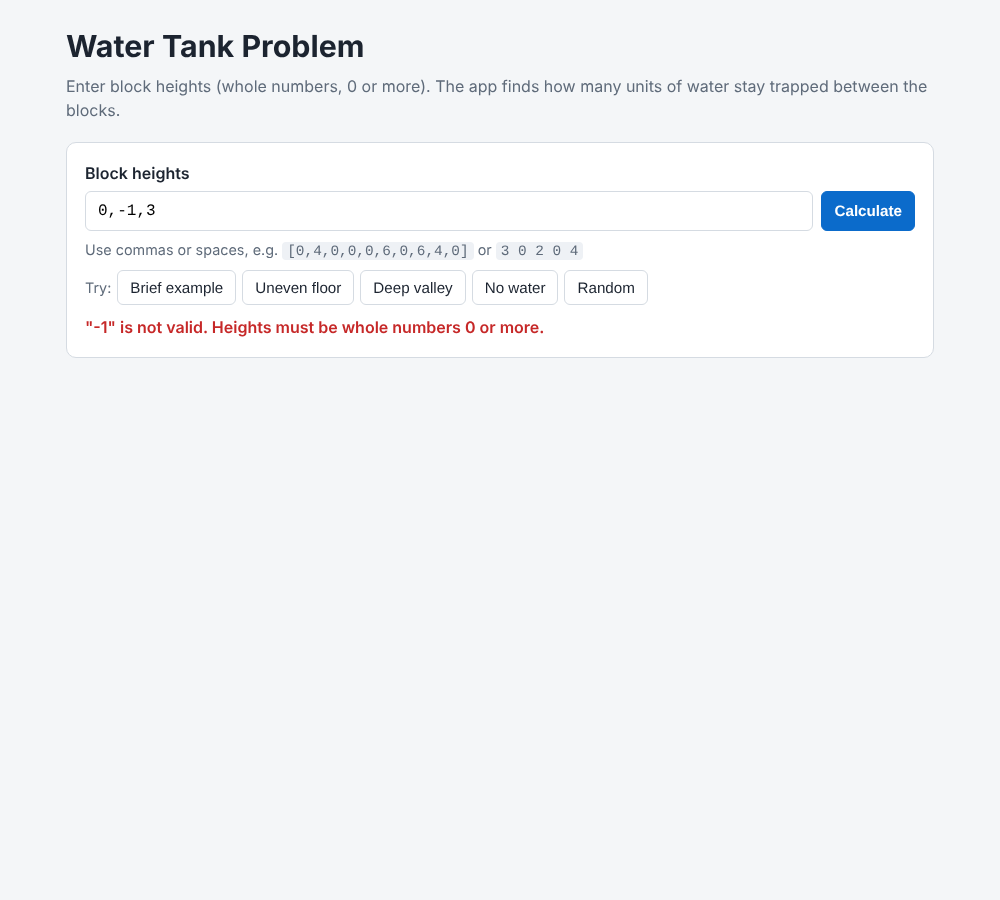
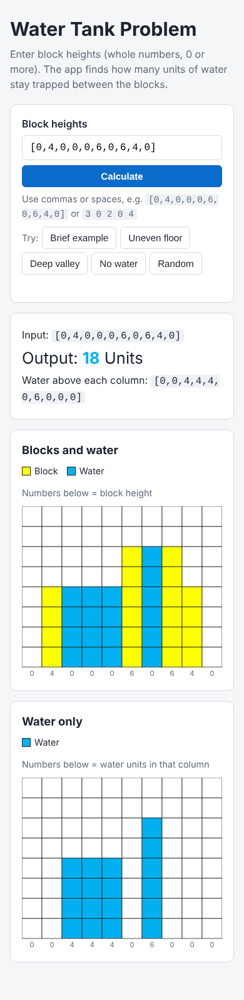

# Water Tank Problem

A small web app built with **Vanilla JavaScript, HTML and CSS** (no frameworks, no libraries) for the Ever Quint interview assignment.

Given a list of block heights (each height `n > -1`, so whole numbers 0 or more), it works out how many **units of water** stay trapped between the blocks and draws the answer as an **SVG grid**.

## Example (from the brief)

- Input: `[0,4,0,0,0,6,0,6,4,0]`
- Output: **18 Units**



## How to run

There is nothing to install or build.

1. Clone the repo.
2. Open `index.html` in any modern browser (Chrome, Edge or Firefox).

To run the logic tests (needs Node.js):

```
node test.js
```

## How the logic works

Water can rest on a column only when there is a taller wall on **both** sides. For each column:

1. `leftMax` = tallest block from the start up to this column
2. `rightMax` = tallest block from this column to the end
3. water level = `min(leftMax, rightMax)`
4. water in this column = water level − block height

Adding up every column gives the total.

| Column | 0 | 1 | 2 | 3 | 4 | 5 | 6 | 7 | 8 | 9 |
|---|---|---|---|---|---|---|---|---|---|---|
| Height | 0 | 4 | 0 | 0 | 0 | 6 | 0 | 6 | 4 | 0 |
| leftMax | 0 | 4 | 4 | 4 | 4 | 6 | 6 | 6 | 6 | 6 |
| rightMax | 6 | 6 | 6 | 6 | 6 | 6 | 6 | 6 | 4 | 0 |
| Water | 0 | 0 | 4 | 4 | 4 | 0 | 6 | 0 | 0 | 0 |

Total = 4 + 4 + 4 + 6 = **18 units**.

- Time: O(n), which is three simple passes over the list
- Extra memory: O(n), for the two helper arrays

## Features

- Input can use commas or spaces, with or without brackets: `[0,4,0]`, `0,4,0` or `0 4 0`
- Input is checked: negative numbers, decimals, text and empty input each show a clear error message
- Two SVG views, the same as the two tables in the brief:
  - **Blocks and water**: yellow blocks and blue water
  - **Water only**: just the trapped water
- Each column is labelled with its block height in the first view and its water units in the second
- The page shows the total units and the water above each column
- Example buttons and a **Random** button to try many cases quickly
- The layout works on phone screens

## Project structure

| File | What it does |
|---|---|
| `index.html` | Page layout: input, results and the two chart areas |
| `style.css` | Styling. Colours match the brief (yellow blocks, blue water) |
| `water.js` | The logic only: reading the input and computing the water. No drawing code |
| `app.js` | Connects the page to the logic and draws the SVG charts |
| `test.js` | Node.js tests for the logic and the input checks |
| `screenshots/` | Snippets of the app running |

The logic in `water.js` is kept apart from the drawing in `app.js`, so the algorithm can be tested on its own without a browser.

## Tests

`node test.js` covers:

- the brief's example (18)
- a well-known mixed case (6)
- a deep valley (9)
- only-rising and only-falling heights (0)
- all zeros, a single block, and an empty list (0)
- input checks: negatives, decimals, text and empty input are all rejected

## Limits

The algorithm itself works for any size of input. The **drawing** accepts up to 60 blocks and heights up to 40, because beyond that the grid cells get too small to read.

## Screenshots

| Uneven floor (6 units) | Invalid input | Mobile |
|---|---|---|
|  |  |  |
